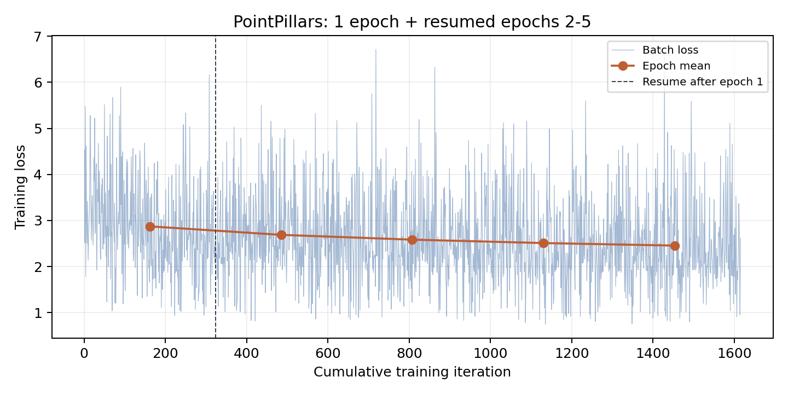
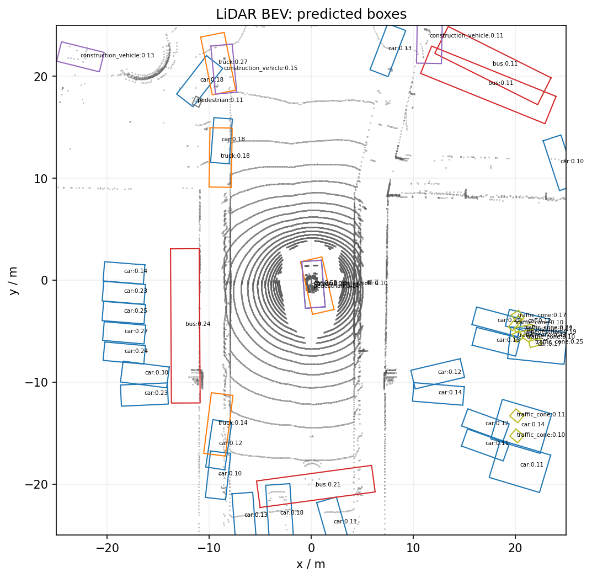

# 自动驾驶技术实验三：PointPillars

姓名：杜承敖；学号：2024302112019。

本目录按照 `Pointpillar指导文档.pdf` 完成 nuScenes mini 单 LiDAR 关键帧实验。
公开权重评估 → 训练 1 轮 → 断点恢复到累计 5 轮 → 固定验证集评估 → 指标对比。

## GitHub 分支成果入口

本分支在实验二分支基础上增加 `stage03/`，保留实验一、二已有文件。

- [正式实验报告 PDF](output/pdf/自动驾驶技术第三次实验报告_杜承敖_2024302112019.pdf)
- [可编辑 Markdown 源稿](output/pdf/实验报告.md) 与 [LaTeX 源稿](output/pdf/pointpillars-latex/main.tex)
- [累计五轮 Loss 曲线](outputs/loss_all_5epochs.png) 与 [微调前后指标](outputs/comparison.json)
- [首轮训练 Log](outputs/setup/run1_console.log)、[续训 Log](outputs/setup/run5_console.log) 和 [验证 Log](outputs/setup/finetuned_console.log)
- [第五轮最终模型](outputs/run5_compact/epoch_5.pth) 与 [最终核验记录](outputs/final_validation.json)

| 相同 81 帧 mini_val | NDS | mAP |
|---|---:|---:|
| 公开权重基线 | 0.026860 | 0.000061 |
| 累计五轮微调 | 0.118891 | 0.062302 |

仓库包含可复现源码、教师提供的原版 MMDetection3D 源码、原始训练/验证记录、缓存预测、图表、报告及公开初始权重、首轮和第五轮模型。未上传原始传感器数据、原始 JSON 元数据、Python 环境、安装缓存和重复的完整提交 ZIP。`data_infos/` 的派生索引通过下面的数据准备命令重建。日志中的本机路径保留为真实运行记录，复现时按自己的目录传参。

若只阅读成果，无需配置训练环境或下载数据。完整 ZIP 提交包保留在本机 `output/submission/`；仓库中的报告、源码和选定模型均直接复制自最终成果。





## 环境

本次独立环境位于 `.env`，不修改实验一和实验二的运行环境。Windows CMD 示例：

```bat
cd /d D:\code\autodrive\stage03
set PYTHONUTF8=1
set NUSCENES_ROOT=D:\code\autodrive\stage03\data\nuscenes
.env\python.exe run_experiment.py
.env\python.exe summarize_results.py
```

重新配置环境时，使用 Python 3.9，先从官方 cu118 索引安装
`torch==2.0.1` 和 `torchvision==0.15.2`，再运行 `install_dependencies.ps1`。
课程指定版本见 `requirements-course.txt`；实际完整依赖锁定见
`outputs/setup/requirements-actual.txt`。`third_party/mmdetection3d-1.4.0`
为教师随包提供的原版源代码，不是另一套自行替代的检测模型。

## 数据准备

数据不随提交包复制；本次复用以下已有本地资料，未下载新数据集：

- 实验二的 `PETR/v1.0-mini/v1.0-mini` 原始 JSON 元数据及配套地图。
- 实验一的 `nuscenes/samples/LIDAR_TOP.tar` 点云压缩包中，对应 mini 的 404 个关键帧。

```bat
python prepare_data.py --metadata 原始mini元数据目录 --lidar-archive 点云压缩包路径
python build_source_infos.py
python preprocess.py
```

准备脚本同时复制元数据目录同级的 `maps` 文件夹到 `data/nuscenes/maps`。
`prepare_data.py` 只提取目标关键帧，不解压历史 sweeps。
`build_source_infos.py` 重新生成 MMDetection3D 1.4 的源索引，并核对
点云有限性、三维框坐标回转误差和官方场景划分；它不复用 PETR 的相机索引。
源索引位于 `data/nuscenes/nuscenes_infos_{train,val}.pkl`，课程索引位于 `data_infos/`。

## 逐步复现

以下命令均在实验三目录、已配置的独立环境中执行。首次运行使用空结果目录，
重复实验应先选择新的工作目录，避免覆盖已有成果。

```bat
python check_environment.py
python check_cuda_ops.py
python preprocess.py
python test.py --checkpoint checkpoints/pointpillars_nuscenes_official.pth --output-dir outputs/baseline_compact_bev --vis-count 3 --score-thr 0.10
python train.py --epochs 1 --work-dir outputs/run1_compact --amp
python plot_training.py --work-dir outputs/run1_compact
python train.py --resume-from outputs/run1_compact/epoch_1.pth --epochs 5 --work-dir outputs/run5_compact --amp
python plot_training.py --work-dir outputs/run5_compact
python test.py --checkpoint outputs/run5_compact/epoch_5.pth --output-dir outputs/finetuned_compact --vis-count 3 --score-thr 0.10
python compare_results.py --baseline outputs/baseline_compact_bev --finetuned outputs/finetuned_compact --run1 outputs/run1_compact --run5 outputs/run5_compact --output outputs/comparison.json
```

`run_experiment.py` 执行上述步骤并保存完整控制台日志；步骤失败会立即停止。
它另存前三个固定验证帧的阈值 0.10 和 0.30 图片，不覆盖低阈值结果。
若流程被中断，可用 `python run_experiment.py --start-from 步骤名` 从未完成步骤继续；
脚本拒绝覆盖已完成的首轮或第五轮检查点。本次基线完成后流程中断，后续使用
`--start-from run1` 完成训练与评估；训练本身另按指导书从首轮检查点恢复至五轮。
`summarize_results.py` 验证五轮检查点、1615 个损失点、81 帧预测 token 一致性，
并生成累计损失曲线和 `outputs/final_validation.json`。

## 结果与提交

- `output/pdf/`：正式 PDF 报告和可编辑 Markdown 源稿。
- `output/pdf/pointpillars-latex/`：沿用前两次报告版式的 LaTeX 源项目（main.tex 和 images/）。正文为宋体、标题为黑体，文档及图中文字统一为黑色。
- 报告包含点云与图像的比较和互补、实际训练 Log / Loss / 验证结果、结合源码的 PointPillars 原理分析。
- `outputs/run1_compact/`：首轮检查点、梯度及参数更新审计、损失图和训练日志。
- `outputs/run5_compact/`：续训日志、审计、损失图和累计第五轮权重。
- `outputs/baseline_compact_bev/` 与 `outputs/finetuned_compact/`：完整验证指标、预测与 BEV 图。
- `outputs/comparison.json`：微调前后指标；`outputs/setup/execution.json`：逐步命令与耗时。
- `inspect_model.py` 在 eval 模式对固定验证帧 0 进行一次前向，不更新权重；`outputs/setup/model_shape_trace.json` 记录各层特征尺寸，作为报告代码理解部分的依据。
- `output/submission/`：本机完整 ZIP 提交包的生成位置；ZIP 不重复存入 GitHub。

仅调整报告格式时，先在实验环境执行 `python replot_report_figures.py`，从缓存预测重绘黑色标注；再执行 `python build_report.py`，使用本机 XeLaTeX 编译报告。此过程不训练、不评估、不改写预测或模型权重。报告保留 2026 年 10 月 13 日的实验日期。

公开权重 SHA256：`f19d00a38e6b775f38a45a9a3ca3ecaec20a5585a3caf44622423e2d5f75d5d0`。

本次仅训练检测头参数；单帧输入，x/y 为 ±25 米，200×200 BEV，batch=1，AMP。
所有验证均使用官方 mini_val 的相同 81 帧。图中是点云和预测框，没有叠加真实框；
展示阈值不改变已计算的 NDS/mAP。教学配置及 mini 数据结果不能替代完整 nuScenes 榜单。

## 本机适配记录

- `course_common.py`：默认数据目录改为本实验目录下的 `data/nuscenes`。
- `preprocess.py`：类别统计由每帧首个标注改为全部检测类别中有 LiDAR 点的标注，统计在范围过滤之前。
- 新增数据准备、CUDA 算子检查、流程执行及最终证据核验脚本。
- 教师已提供标准命名的权重和展开配置，因此直接校验现有文件，不使用要求另一套源文件名的复制脚本。

第三方源码与权重保留原有许可及来源。本地压缩包内的数据、缓存和完整 Python 环境不属于提交内容。
