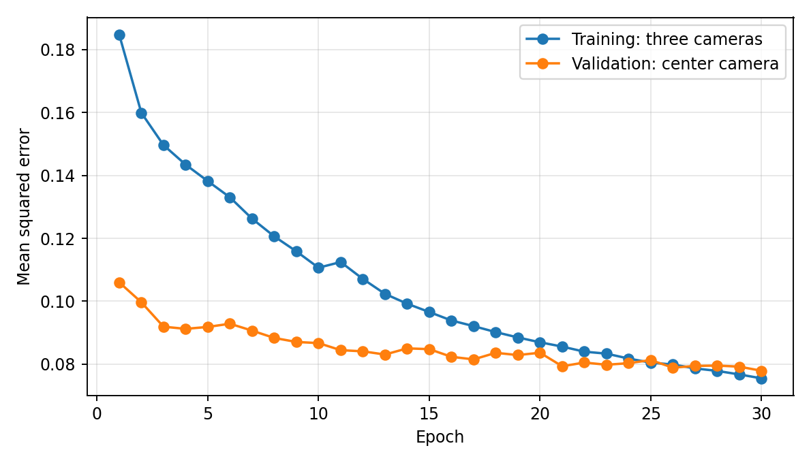
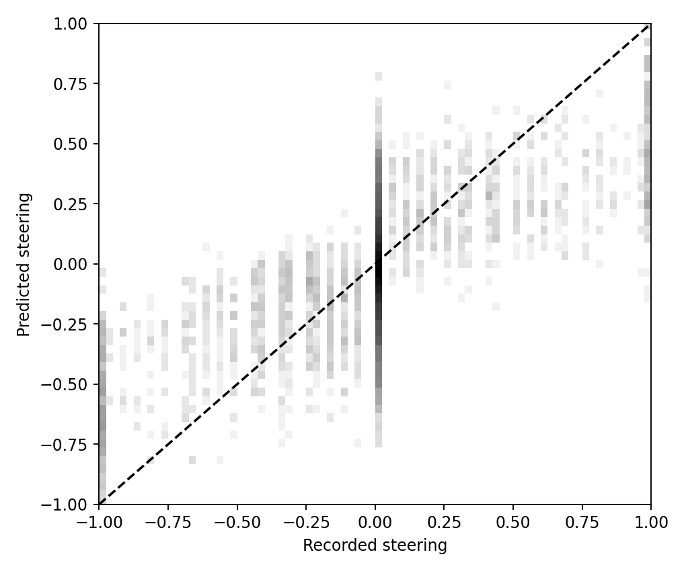

# 自动驾驶技术实验四：端到端行为克隆

姓名：杜承敖；学号：2024302112019。当前成果来自 2026 年 11 月的课程实验。

## GitHub 分支成果入口

本目录位于统一的 `final-report` 分支，保留实验四的最终成果；四个阶段和结课报告的入口见仓库首页。

- [最终增图版实验报告 PDF](output/pdf/自动驾驶技术第四次实验报告_杜承敖_2024302112019_增图版.pdf)
- [LaTeX 源码](output/pdf/report.tex)及其 [配图](output/pdf/figures/)
- [30 轮训练记录](outputs/run30/history.json)、[训练配置](outputs/run30/config.json)和[离线验证结果](outputs/run30/evaluation.json)
- [第 1 至 5 轮日志](outputs_train.log)、[第 6 至 30 轮日志](outputs_train30.log)
- [最佳模型](outputs/run30/model-best.h5)（第 30 轮；文件为 PyTorch checkpoint，扩展名沿用上游约定）
- [合成通信记录](outputs/synthetic_telemetry.json)、[服务日志](outputs/drive.log)和[模拟器测试状态](outputs/simulator_status.txt)
- [课程指导书](端到端自动驾驶模型_实践指导文档.pdf)、[上游来源与适配说明](upstream/ORIGIN.md)

| 训练轮数 | 总记录数 | 训练 / 验证记录 | 验证 MSE | 验证 MAE | 验证 RMSE |
|---:|---:|---:|---:|---:|---:|
| 30 | 32,443 | 25,954 / 6,489 | 0.077897 | 0.207337 | 0.279101 |

训练使用三相机并进行水平翻转；验证仅使用中央相机且不增强。随机按记录划分的相邻帧具有相关性，验证集也用于选择模型，因此这些数值不能替代独立场景测试或闭环驾驶评价。





## 文件与提交范围

本目录包含实际使用的训练、评估、预处理一致性检查和通信检查代码，必要上游源码及 MIT 许可，最终报告及 LaTeX 源码、选定模型和真实训练评估记录。原始数据、模拟器安装包、Python 环境、每轮重复模型和完整提交 ZIP 保留在本机，不存入仓库。

`package_submission.py` 保留本机原打包脚本：它依赖旧正式报告文件名；本分支的成果入口以上面的增图版报告为准，不依赖该打包脚本。

## 环境与数据

原实验使用 Windows、Python 3.9、PyTorch 2.0.1+cu118、torchvision 0.15.2+cu118 和 RTX 4060 Laptop GPU。训练依赖见 `requirements-course.txt`；模拟器通信依赖单独安装，不混入训练环境。

以下命令均在本目录执行。先准备课程 `dataset.zip`，使 `dataset/driving_log.csv` 和 `dataset/IMG/` 存在。

```powershell
python -m pip install torch==2.0.1 torchvision==0.15.2 --index-url https://download.pytorch.org/whl/cu118
python -m pip install -r requirements-course.txt
python -B check_pipeline.py
python -u train.py --epochs 5 --output outputs/reproduce5
python -u train.py --epochs 30 --resume outputs/reproduce5/model-5.h5 --output outputs/reproduce30
```

使用不存在的新输出目录，避免覆盖已有记录。续训恢复模型、Adam、学习率调度器和轮次，但重新设置随机种子，未恢复中断时的随机数状态，不保证与连续训练逐位一致。模型保留 NVIDIA 原结构；课程训练器使用批次平均梯度更新，不等同上游逐视角三次更新。

`evaluate.py` 使用 CUDA，固定读取 `outputs/run30/model-best.h5` 和课程数据，重新评估将更新该目录的指标与图表。`check_pipeline.py` 核验训练 BGR 和模拟器 RGB 转换后的预处理一致性，以及输入尺寸和模型前向计算。

## 模拟器通信与测试边界

```powershell
python -m pip install --target sim_deps -r requirements-simulator.txt
$env:PYTHONPATH=(Join-Path (Get-Location) 'sim_deps')
python -u upstream/src/drive.py outputs/run30/model-best.h5
```

服务先启动，再运行课程模拟器，选择 Lake Track 和 AUTONOMOUS MODE。服务使用 4567 端口，输出转角和按速度、转角计算的油门；定义的 PI 控制器未启用。记录目录必须使用不存在的新路径。

`check_socket.py` 发送本地记录图像构造的合成遥测，仅检查解码、模型推理和 SocketIO 响应，不是模拟器闭环。历史实验未取得可操作的模拟器窗口及实际赛道行驶证据，不能声称已完成闭环验收。

## 编译报告

在 `output/pdf/` 下使用 XeLaTeX 连续编译三次 `report.tex`。源码通过相对路径引用 `figures/` 及 `../../outputs/run30/` 中的损失与预测图，目录关系须保留。字体使用 Windows 中文字体，编译输出默认名为 `report.pdf`。
